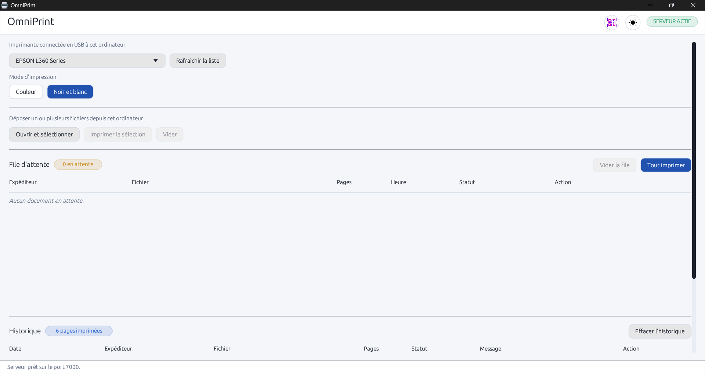
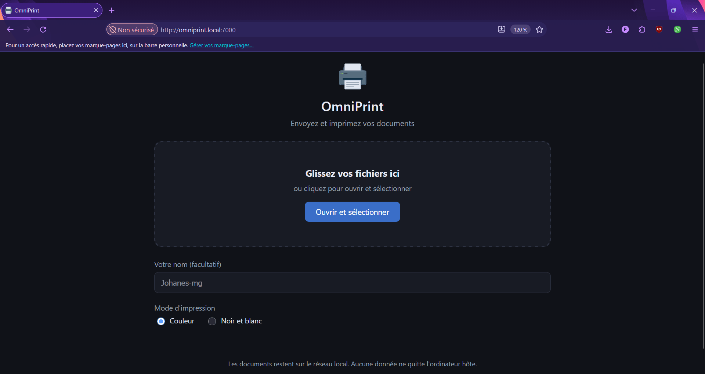
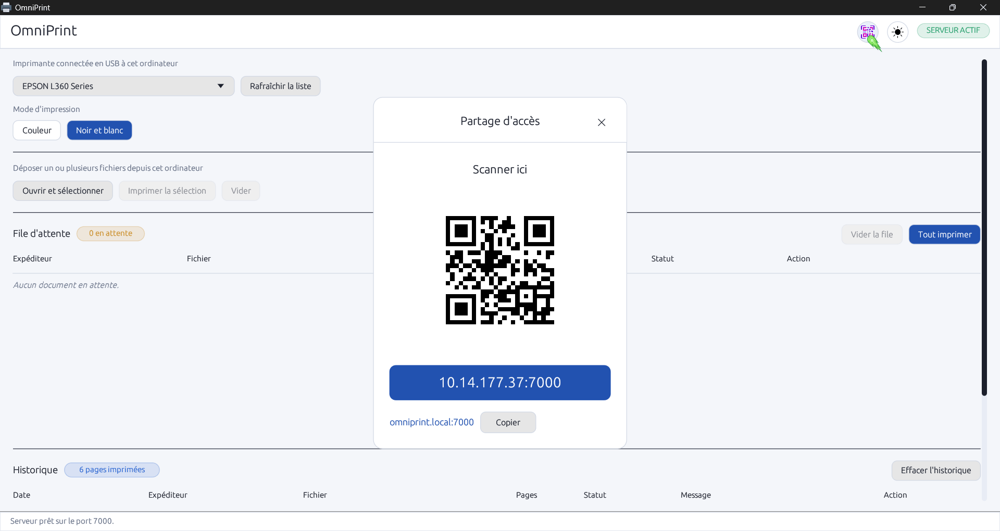
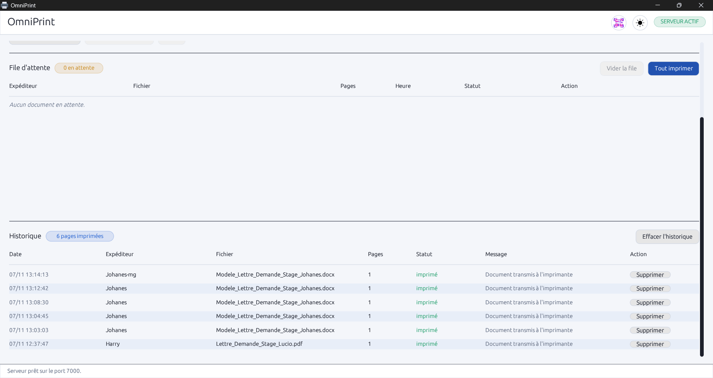
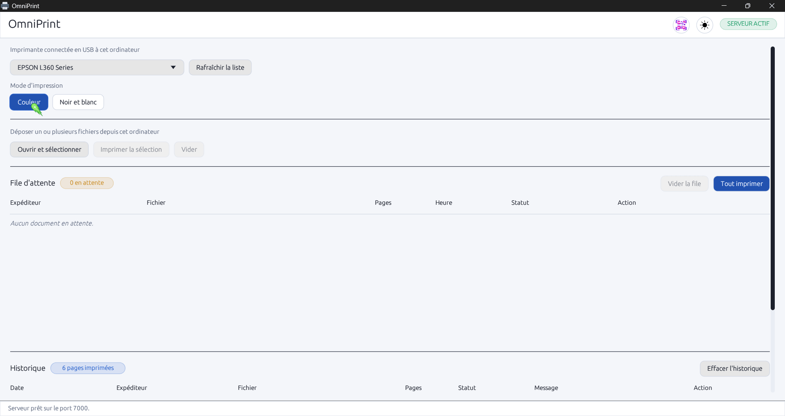
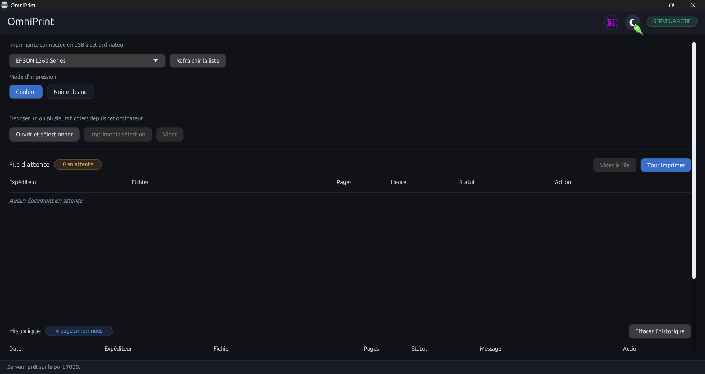

# OmniPrint

<div align="center">

<div align="center">
  
</div>

**Lightweight multi-user print server for Windows, built in Rust with egui, served to any browser on the local network.**

[](LICENSE)
[](https://www.rust-lang.org)
[](https://www.microsoft.com/windows)

</div>

---

## About OmniPrint

**OmniPrint** is a compact Windows application that turns any computer connected to a USB printer into a small local print server. It exposes a lightweight web interface over the local network so that other computers, tablets, and smartphones can send documents to the shared printer without installing anything.

Built entirely in **Rust** with **egui/eframe**, it combines a native desktop experience on the host with an embedded HTTP server and a modern, responsive web client, keeping the footprint low and the behaviour predictable.

---

## Main Features

- **Dual role by design** : the host machine runs the native UI and the printer bridge, while clients only use a browser.
- **Embedded web server** : served directly by the host, no external server, no static files required on the client.
- **Drag and drop or file picker** : users can drop documents from any device or open the native browser file dialog.
- **Sender identification** : each client can fill in an optional name shown in the host queue and history.
- **Colour mode selection** : choose Colour or Black and White from the desktop app or the web page before printing.
- **Print queue and history** : both views show sender, file name, page count, timestamp, and status, with per-row removal and global clear.
- **Silent printing** : PDF files are routed through a bundled SumatraPDF when available, with a Microsoft Edge headless fallback.
- **Automatic firewall rule** : the app creates the required inbound rule on first run, with UAC elevation when needed.
- **Automatic port fallback** : if the default port is already taken, OmniPrint selects the next available one within a short range.
- **mDNS discovery** : the host is reachable as `omniprint.local` on compatible devices, while the raw IP address always remains displayed as the fallback.
- **Persistent session** : role, printer, colour mode, and theme are restored on the next launch.
- **Dark and light theme** : a single round toggle switches the entire desktop UI.

---

## Interface Overview

<div align="center">

### Host desktop application



### Web client served to the local network



### Share panel with QR code



### Print queue and history



### Colour mode selection



### Light theme



</div>

---

## Technologies Used

- **[Rust](https://www.rust-lang.org/)** : systems programming language guaranteeing safety and speed.
- **[egui / eframe](https://github.com/emilk/egui)** : immediate mode GUI framework for Rust.
- **[tiny_http](https://github.com/tiny-http/tiny-http)** : synchronous embedded HTTP server.
- **[mdns-sd](https://github.com/keepsimple1/mdns-sd)** : mDNS service announcement on the local network.
- **[qrcode](https://github.com/kennytm/qrcode-rust)** : QR code generation for the share panel.
- **[image](https://github.com/image-rs/image)** : PNG decoding for the logo and interface icons.
- **[serde / serde_json](https://serde.rs/)** : session and journal serialisation.
- **[chrono](https://github.com/chronotope/chrono)** : timestamps on journal entries.
- **[uuid](https://github.com/uuid-rs/uuid)** : unique job identifiers.
- **[rfd](https://github.com/PolyMeilex/rfd)** : native file picker on the host.
- **[SumatraPDF](https://www.sumatrapdfreader.org/)** : silent PDF printing, bundled in `bin/`.

---

## Project Structure

Here is the tree and file organisation of the solution:

- OmniPrint/
  - images/
    - logo.png
    - logo.ico
    - light.png
    - dark.png
    - popup.png
  - bin/
    - SumatraPDF.exe
  - src/
    - app.rs
    - config.rs
    - journal.rs
    - main.rs
    - mdns.rs
    - pare_feu.rs
    - printer.rs
    - reseau_utils.rs
    - session.rs
    - theme.rs
    - web.rs
  - Installeur/
  - .cargo/
    - config.toml
  - .gitignore
  - Cargo.lock
  - Cargo.toml
  - README.md
  - rust-toolchain.toml

### Source code responsibilities

| File | Responsibility |
|---|---|
| src/main.rs | Program entry point and viewport setup |
| src/app.rs | Main egui application, UI composition, orchestration |
| src/config.rs | Application name, default port, AppData paths |
| src/session.rs | Persistent user session (role, printer, colour mode, theme) |
| src/journal.rs | In-memory and on-disk print job journal |
| src/printer.rs | Printer enumeration, silent printing, page counting |
| src/web.rs | HTTP server, embedded web client, multipart handling |
| src/mdns.rs | mDNS announcement for the host |
| src/pare_feu.rs | Windows Firewall rule creation with UAC fallback |
| src/reseau_utils.rs | Local IPv4 address detection |
| src/theme.rs | Colour palettes, theme switching, custom widgets |

---

## Installation and Build

### Prerequisites

Make sure **Rust** is installed (stable channel recommended). You can get it from rustup.rs.

The project also targets the Windows gnullvm toolchain. Add it once with:

```bash
rustup target add x86_64-pc-windows-gnullvm
```

### Building from source

1. Clone the repository:

```bash
git clone https://github.com/Johanes-mg/OmniPrint.git
cd OmniPrint
```

2. Build the project in **release** mode (optimised for performance):

```bash
cargo build --release
```

3. The generated executable will be located at:

```bash
target/x86_64-pc-windows-gnullvm/release/omniprint.exe
```

## How It Works

1. Launch OmniPrint on the computer connected to the USB printer.
2. A large address such as `http://192.168.1.42:47823` appears in the app, together with a QR code in the share panel.
3. Other users open this address in their browser, or scan the QR code from a smartphone.
4. They drop files, optionally enter their name, and click **Print**.
5. The host queue shows the sender, the file name, the page count, the timestamp, and the current status.

No document ever leaves the local network. Only the host machine talks to the printer.

---

## Data and Persistence

OmniPrint stores its state in the Windows AppData directory:

- `%APPDATA%\OmniPrint\session.json` : user preferences (role, printer, colour mode, theme).
- `%APPDATA%\OmniPrint\journal.json` : full print job history.
- `%APPDATA%\OmniPrint\documents\` : documents received from the web client.

Backing up these files preserves the full history and preferences. Deleting them resets the application to its default state.

---

## Privacy

No data is sent outside the local network. Received documents are stored locally in the AppData directory, and the print history is kept as a plain JSON file on the host machine.

---

## Author

**Johanes-mg**

## License

This project is released under an open license. See the LICENSE file for details.
